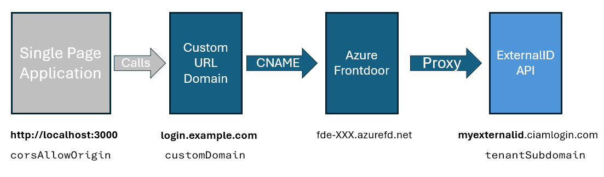

# Azure Frontdoor based CORS Preoxy for Native Authentication APIs using Azure Developer CLI

This repository contains an Azure Frontdoor reference sample deployed to Azure using Azure Developer CLI (`azd`). The sample uses External ID Custom URL Domains and Azure Frontdoor to support Single Page Applications to use External ID Native Authentication APIs and SDKs.

## Prerequisites

+ [Azure Developer CLI (`azd`)](https://learn.microsoft.com/azure/developer/azure-developer-cli/install-azd)
+ A [Custom URL Domain](https://learn.microsoft.com/en-us/entra/external-id/customers/how-to-custom-url-domain) configured for your External ID tenant.

## Configuration

The template relies upon you already having a validated Custom URL Domain within your External ID tenant (e.g. `login.example.com`).  It will create an Azure Frontdoor instance which can be connected to your Custom URL Domain via a `CNAME` DNS Record.  The Azure Frontdoor will proxy all requests to your External ID endpoint (e.g.`myexternalid.ciamlogin.com`). You will be prompted for three configuration values (`corsAllowedOrigin`, `customDomain`, and `tenantSubdomain`) which you can see in the diagram below:



## Deployment

1. Run the following command to initialize the project.

```bash
azd init --template https://github.com/jamesc/ms-identity-ciam-cors-proxy-frontdoor
```

This command will clone the code to your current folder and prompt you for the following information:

- `Environment Name`: This will be used as a prefix for the resource group that will be created to hold all Azure resources. This name should be unique within your Azure subscription.


2. Run the following command to provision the template's infrastructure to Azure.

```bash
azd up
```

This command will prompt you for the following information:
- `Azure Location`: The Azure location where your resources will be deployed.
- `Azure Subscription`: The Azure Subscription where your resources will be deployed.
- `corsAllowedOrigin` parameter: The origin domain to allow CORS requests from in the format of `SCHEME://DOMAIN:PORT`, e.g. `http://localhost:3000`.
- `tenantSubdomain` parameter: The subdomain of the External ID tenant that we will proxy (This is the portion of the primary domain before the `.onmicrosoft.com` part, e.g. `mytenant`).
- `customDomain` parameter: The full URL of the custom domain configured within External ID ,e.g. login.example.com


> NOTE: This may take a while to complete as it provisions Azure resources. You will see a progress indicator as it provisions the resources.

You can see configuration information by running `azd env get-values`.  An example output showing the relevant values is below.

```bash
> azd env get-values
AZURE_ENV_NAME="cors-proxy-frontdoor"
...
...
CORS_PROXY_ENDPOINT="https://login.example.com/myexternalid.onmicrosoft.com/"
CUSTOM_DOMAIN_DNS_EXPIRY="2025-02-07T12:48:37.5716596+00:00"
CUSTOM_DOMAIN_DNS_TXT_DOMAIN="example.com"
CUSTOM_DOMAIN_DNS_TXT_NAME="_dnsauth.login"
CUSTOM_DOMAIN_DNS_TXT_VALUE="_XXXXXXXXXXXXXXXXXXXXXXXX"
FRONTDOOR_ENDPOINT="fde-XXX-YYY.z02.azurefd.net"
```

3. After the template is deployed, you need to manually update your DNS Zone to a) setup the CNAME to link the custom domain to the Azure Frontdoor endpoint, and b) validate the DNS entry for the custom domain.

    a. Create a CNAME record for your custom domain pointing to the frontdoor endpoint specified in `FRONTDOOR_ENDPOINT`.

    b. To validate your DNS entry for the custom domain, you need to create a new `TXT` entry in the DNS Zone.  To do this, use the three entries starting with `CUSTOM_DOMAIN_DNS_`:

    You need to create a `TXT` record with the zone shown by `CUSTOM_DOMAIN_DNS_TXT_DOMAIN`.  The record must be named as shown in `CUSTOM_DOMAIN_DNS_TXT_NAME` with the value in `CUSTOM_DOMAIN_DNS_TXT_VALUE`. E.g, for the values shown above, we would add a `TXT` entry in the zone file for `example.com`.  The record would be names `_dnsauth.login` and have the value `_XXXXXXXXXXXXXXXXXXXXXXXX`.

    It will take a few minutes for this information to propogate to Azure Frontdoor where you will see that the domain is validated and traffic is flowing.

4. Configure your Single Page Application using the `CORS_PROXY_ENDPOINT` value shown by `azd env get-values`.

## Clean up resources

When you're done working with your proxy and related resources, you can use this command to delete the resources from Azure and avoid incurring any further costs:

```shell
azd down
```
